<!-- Generated by scripts/build.py — edit scripts/content.py, then run: python scripts/build.py -->

<a href="https://ismailsalha.vercel.app"></a>

<a href="https://ismailsalha.vercel.app/#about">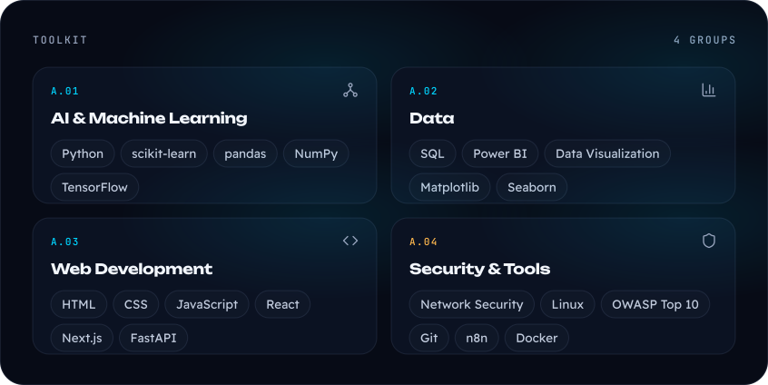</a>

<a href="https://github.com/ismailsalha?tab=repositories">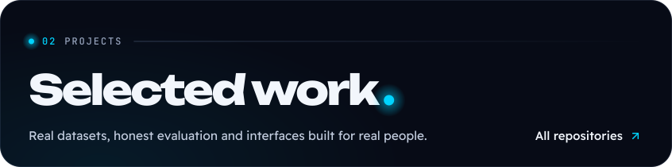</a>

<a href="https://t.me/radar_forsa">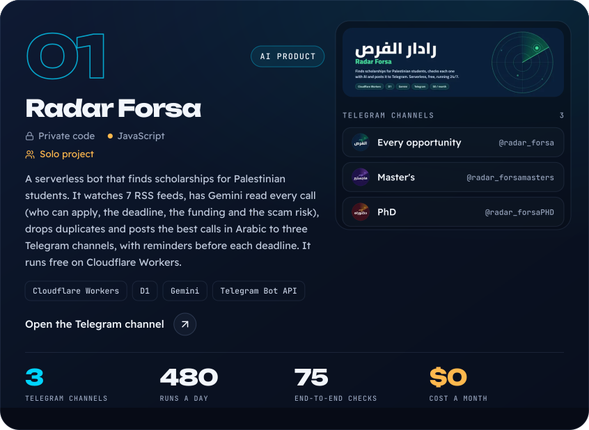</a>

<a href="https://nashrati.online">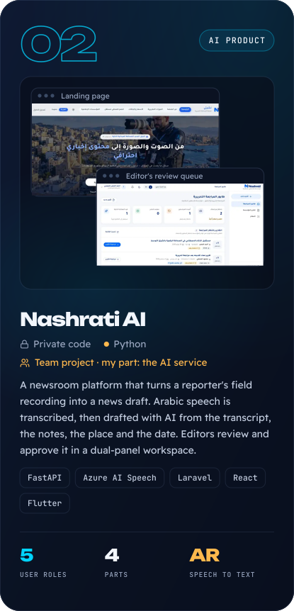</a> <a href="https://ismailsalha.vercel.app/#projects">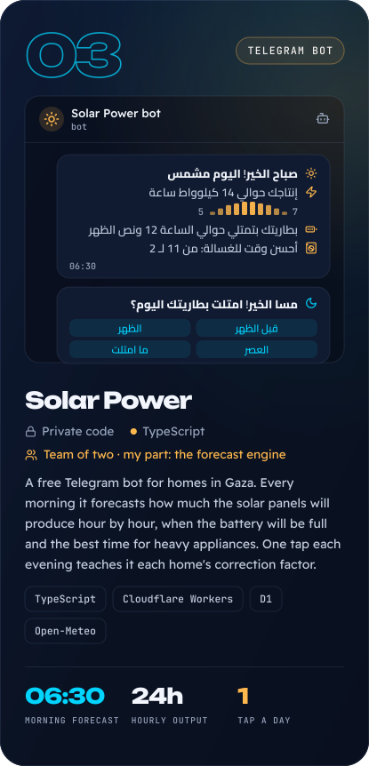</a>

<a href="https://github.com/ismailsalha/ML-Finalproject1">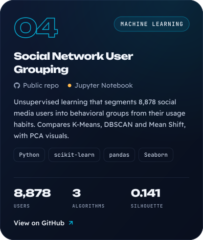</a> <a href="https://github.com/ismailsalha/Ismail_Salha_Project">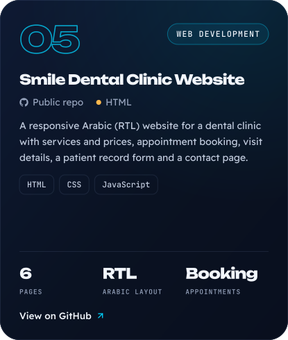</a>

<a href="https://github.com/ismailsalha/Pattern_Recognition_Research_Report">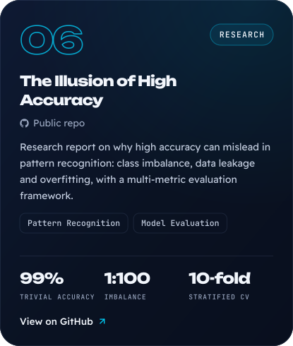</a> <a href="https://github.com/ismailsalha/ismailsalhaAssignment1Preprocessingnew">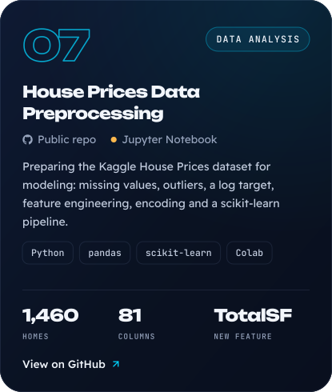</a>

<a href="https://ismailsalha.vercel.app/#experience">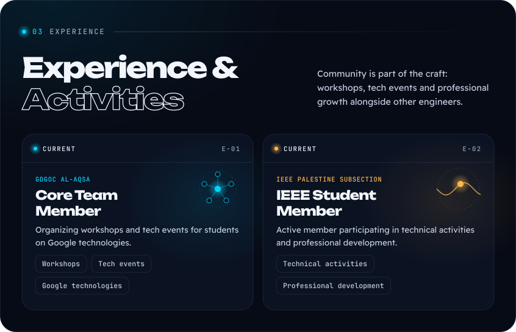</a>

<a href="mailto:ismailsalha21@gmail.com"></a>

 

 

<a href="https://ismailsalha.vercel.app">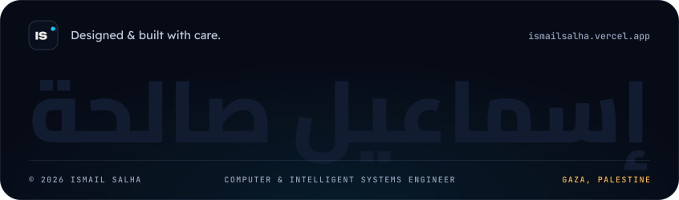</a>
